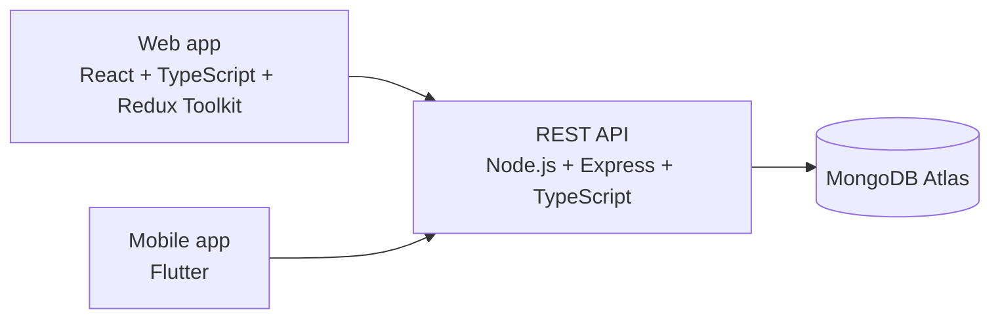
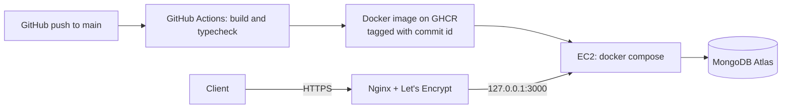

# Splitwise Clone

A full-stack expense sharing app built in public over 15 days. One backend, two clients: a React web app and a Flutter mobile app, both talking to the same REST API.

Track shared expenses with friends and groups, split bills three different ways, see who owes whom, and settle up.

> Status: backend complete and deployed. Live API: https://splitwise-clone.duckdns.org/api/health. Web and mobile clients are next. See the [progress log](#progress-log).

## Features

**Done**
- JWT authentication (register, login, protected routes) with zod validation
- Groups: create a group, add members, list your groups, view group details
- Friends: add a friend by email, plus a friends list that merges people from shared groups and direct adds
- Expenses with server side validation (group membership, payer, participants)
- Three split types: equal, exact amount, and percentage
- Group expense history, newest first, with payer and split users populated
- Balance calculation per group, with debt simplification (fewest payments to settle everyone)
- Settle up and a group activity feed
- Dockerized, deployed on AWS with HTTPS, CI and one command rollback

**Planned**
- React web app and Flutter mobile app

## Architecture



Both clients use the same API, so all business rules (split math, validation, permissions) live on the server only.

## Tech stack

| Layer | Choice |
|---|---|
| Backend | Node.js, Express, TypeScript, Mongoose |
| Database | MongoDB Atlas |
| Auth | JWT and bcrypt |
| Validation | zod |
| Testing | Jest and ts-jest |
| Web (planned) | React, TypeScript, Redux Toolkit, React Router, Tailwind |
| Mobile (planned) | Flutter |

## The split engine

The most interesting part of the project. All money math is done in integer cents, never in decimals, so totals always reconcile exactly.

| Type | Client sends | Server does |
|---|---|---|
| Equal | participants | divides the total fairly among them |
| Exact | an amount per person | checks the amounts add up to the total |
| Percentage | a percentage per person | checks they add up to 100, converts to amounts |

**Why integer cents.** In JavaScript, `0.1 + 0.2` is `0.30000000000000004`, and splitting 10.00 three ways with plain rounding gives 3.33 x 3 = 9.99, so a cent disappears. Working in cents makes the leftover visible so it can be assigned on purpose.

**Equal split.** 10.00 among 3 people is 1000 cents. Each person gets 333, and the 1 leftover cent goes to the first person: 3.34, 3.33, 3.33.

**Percentage split.** Percentages are converted to basis points (33.33% becomes 3333) so they can be summed exactly. Each share is floored to whole cents, then the missing cents are given to the people with the largest fractional remainders (the largest remainder method). Example: 20.00 split 33.33 / 33.33 / 33.34 gives 6.67, 6.66, 6.67.

The calculator is a set of pure functions (no database, no Express), which makes them easy to unit test. Every result is checked to sum exactly to the total before it is saved.

Currency is fixed to USD for now.

## Getting started

### Prerequisites
- Node.js 24 (or Docker)
- A MongoDB Atlas cluster (the free tier works)

### Setup

```bash
git clone [your-repo-url]
cd [repo-folder]/backend
npm install
cp .env.example .env
```

Fill in `.env`:

```
PORT=5000
MONGO_URI=your_mongodb_atlas_connection_string
JWT_SECRET=your_secret
CORS_ORIGINS=http://localhost:5173
```

### Run

```bash
npm run dev      # start the server with auto reload
npm test         # run the unit tests
```

Check that it works: `GET http://localhost:5000/api/health` should return a 200.

## Deployment

The backend runs on a single AWS EC2 instance (Ubuntu) behind Nginx with HTTPS.



**How it works**

- **Image:** a multi stage Dockerfile (`node:24-slim`) builds the TypeScript, then ships only production dependencies and compiled output, running as the non root `node` user.
- **CI:** on every push to `backend/**`, GitHub Actions installs, builds, and on `main` pushes the image to GitHub Container Registry, tagged with the 7 character commit id and `latest`.
- **Server:** Docker Compose runs the container with a health check, a memory limit, log rotation and `restart: unless-stopped`. The port is bound to `127.0.0.1` only, so the container is reachable only through Nginx.
- **Edge:** Nginx terminates TLS (Let's Encrypt via certbot), proxies `/api/` to the container, and drops requests for unknown hosts.
- **Secrets:** `MONGO_URI` and `JWT_SECRET` live in `app.env` on the server (`chmod 600`), never in the repo or the image. The Atlas network allowlist contains only the server's Elastic IP.
- **Shutdown and health:** the app handles SIGTERM gracefully. `GET /api/health` returns 503 when the database is down, which is what the health check and deploys rely on.

**Deploying a version**

```bash
cd ~/splitwise
./deploy.sh <image-tag>      # for example: ./deploy.sh 363af9c
```

The script pulls the new image first (a bad tag changes nothing), switches over, and waits for the health check. If the new version is not healthy within 120 seconds, it prints the logs and automatically rolls back to the previous tag.

**Files in `deploy/`**

| File | Purpose |
|---|---|
| `docker-compose.yml` | Production service definition |
| `deploy.sh` | Pull, switch, wait for health, roll back on failure |
| `nginx.conf` | Reverse proxy and HTTPS config used on the server |
| `app.env.example` | Names of the secrets the server needs |

Deploys are triggered manually for now. Automatic deploys from CI are a planned improvement.
## API overview

All routes are under `/api`. Everything except register and login needs an `Authorization: Bearer <token>` header.

**Auth**

| Method | Route | Description |
|---|---|---|
| POST | `/auth/register` | Create an account |
| POST | `/auth/login` | Log in and receive a JWT |
| GET | `/auth/me` | Current user |

**Groups**

| Method | Route | Description |
|---|---|---|
| POST | `/groups` | Create a group |
| GET | `/groups` | List your groups |
| GET | `/groups/:id` | Group details with members |
| POST | `/groups/:id/members` | Add a member |
| GET | `/groups/:id/expenses` | Expenses in a group, newest first |

**Friends**

| Method | Route | Description |
|---|---|---|
| POST | `/friends/add` | Add a friend by email |
| GET | `/friends` | List your friends |

**Expenses**

| Method | Route | Description |
|---|---|---|
| POST | `/expense` | Create an expense (equal, exact, or percentage) |

Example, equal split between two of three group members:

```json
{
  "description": "Taxi",
  "amount": 30,
  "groupId": "<group id>",
  "paidBy": "<user id>",
  "splitType": "equal",
  "participants": ["<user id>", "<user id>"]
}
```

Example, percentage split:

```json
{
  "description": "Rent",
  "amount": 1000,
  "groupId": "<group id>",
  "paidBy": "<user id>",
  "splitType": "percentage",
  "splits": [
    { "user": "<user id>", "percentage": 50 },
    { "user": "<user id>", "percentage": 30 },
    { "user": "<user id>", "percentage": 20 }
  ]
}
```

A Postman collection is saved in `/backend/postman`.

## Project structure

```
.
├── backend/
│   ├── src/
│   │   ├── config/         database connection
│   │   ├── models/         Mongoose schemas
│   │   ├── types/          shared TypeScript types
│   │   ├── controllers/    request handlers
│   │   ├── routes/         route definitions
│   │   ├── middlewares/    auth and validation
│   │   ├── validations/    zod schemas
│   │   ├── utils/          split calculator and helpers
│   │   ├── app.ts          Express app setup
│   │   └── index.ts        entry point
│   └── postman/
├── deploy/                 compose file, deploy script, nginx config
├── .github/workflows/      CI: build and publish the image
├── web/                    planned
└── mobile/                 planned
```

## Progress log

| Day | What shipped |
|---|---|
| 1 | Repo setup, data models, Express and TypeScript server connected to MongoDB Atlas |
| 2 | Auth: register, login, JWT middleware, zod validation |
| 3 | Groups and friends |
| 4 | Expense model, equal split, group expenses endpoint |
| 5 | Exact and percentage splits, split calculator tests |

## Roadmap

1. Balance engine and debt simplification
2. Settle up and activity feed
3. React web app
4. Flutter mobile app
5. Deploy backend (Render or Railway or AWS) and web (Vercel)
